# 白黒 shirokuro

My Hyprland setup. *Shirokuro* means black and white: that, plus grey and one accent colour. The bar, launcher, panels and notifications are all written in QML with [Quickshell](https://quickshell.org).

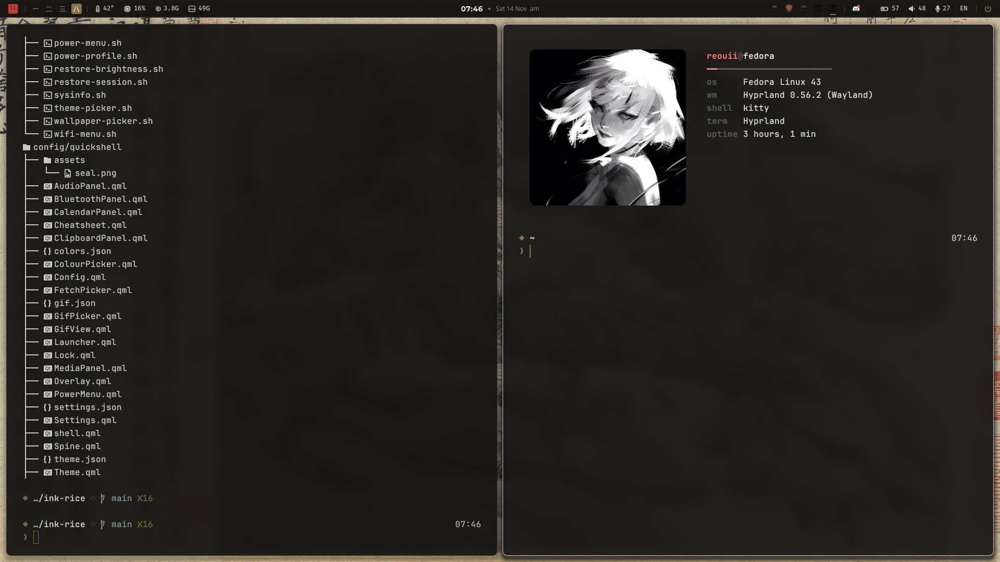

Fedora 43 · Hyprland · Quickshell · kitty · zsh + starship · fastfetch

## Install

You need Hyprland and Quickshell already installed.

```bash
git clone https://github.com/0xSaud/shirokuro.git
cd shirokuro

# back up what you have
mkdir -p ~/rice-backup
cp -r ~/.config/{hypr,quickshell,kitty,themes,fastfetch,starship.toml} ~/.zshrc ~/rice-backup/ 2>/dev/null

# copy the files
cp -r config/* ~/.config/
mkdir -p ~/.local/bin && cp bin/fetchpic ~/.local/bin/
cp zshrc ~/.zshrc

# the files use my username, swap it for yours
grep -rl reouii ~/.config/{hypr,quickshell,themes,kitty,fastfetch} ~/.local/bin/fetchpic ~/.zshrc \
  | xargs sed -i "s/reouii/$USER/g"

# make your seal and your colours
~/.config/themes/bin/gen-seal.py --text "$USER"
~/.config/themes/bin/apply-colors.sh --source '#cf2a27'
```

Then fix the two `monitor=` lines at the top of `~/.config/hypr/hyprland.conf` for your screens, and log out and back in.

Wallpapers and GIFs are not included. Put your own in `~/Pictures/Wallpapers` and `~/Pictures/gifs`.

### Packages

- **Core:** hyprland, hypridle, hyprlock, quickshell, kitty, zsh, starship, fastfetch
- **Used by the scripts:** jq, python3 (Pillow, numpy), ImageMagick, zenity, NetworkManager, PipeWire, tuned-ppd
- **Wallpaper:** swww (called `awww` on Fedora 43), mpvpaper for video
- **Screenshots and recording:** grim, slurp, swappy, wf-recorder, hyprpicker, hyprsunset
- **Clipboard:** cliphist, wl-clipboard
- **Terminal:** fzf, fd, eza, bat, zoxide, zsh-autosuggestions, zsh-syntax-highlighting
- **Fonts:** JetBrains Mono, FiraCode Nerd Font, Montserrat, Open Sans, any CJK font

## Shortcuts

| Keys | What it does |
|---|---|
| `SUPER + Q` | Terminal |
| `SUPER + E` | Files |
| `SUPER + C` | Close window |
| `SUPER + F` / `V` | Fullscreen / float |
| `SUPER + H J K L` | Move focus |
| `SUPER + 1…9, 0` | Workspace 1–10 |
| `SUPER + SHIFT + 1…9, 0` | Send window to workspace |
| `ALT + Space` | Launcher |
| `ALT + Tab` | Window switcher |
| `SUPER + N` | Control Center |
| `SUPER + O` | Music |
| `SUPER + B` | Hide / show the bar |
| `SUPER + T` / `W` / `G` | Colours / wallpaper / GIF |
| `SUPER + I` | Settings |
| `SUPER + A` / `D` | Mixer / calendar |
| `SUPER + /` | All shortcuts |
| `CTRL + B` | Clipboard history |
| `SUPER + Space` | Switch keyboard layout |
| `SUPER + Escape` | Power menu |
| `Print` | Screenshot |
| `SUPER + ALT + R` / `X` | Record / stop |

## Screenshots

**Bar**: right-click a window icon to quit it, `SUPER + B` to hide the bar.

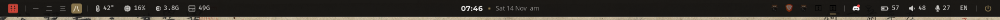

**Launcher**

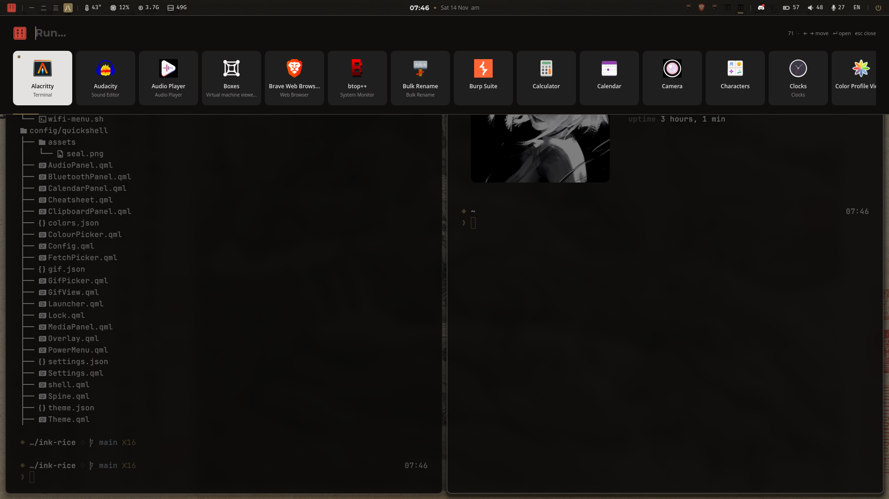

**Control Center**

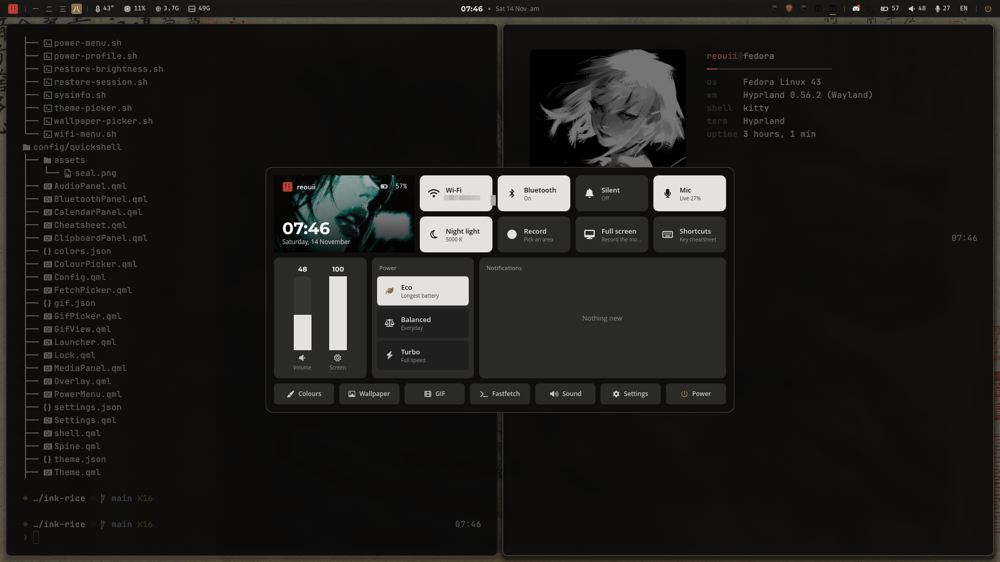

**Music**

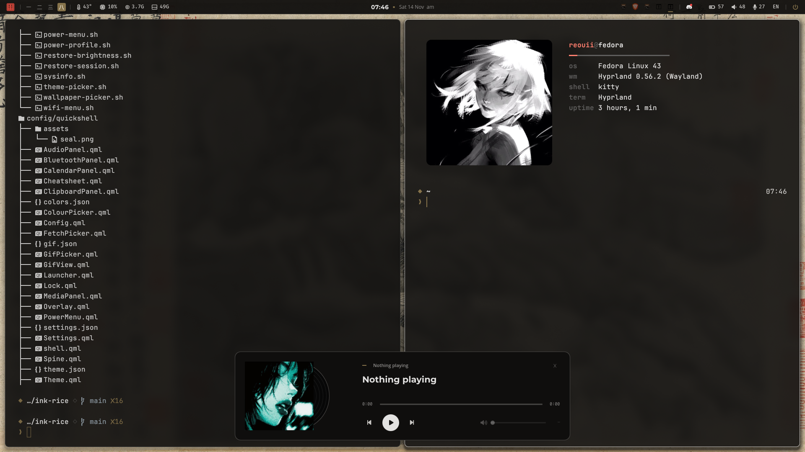

**Power menu**

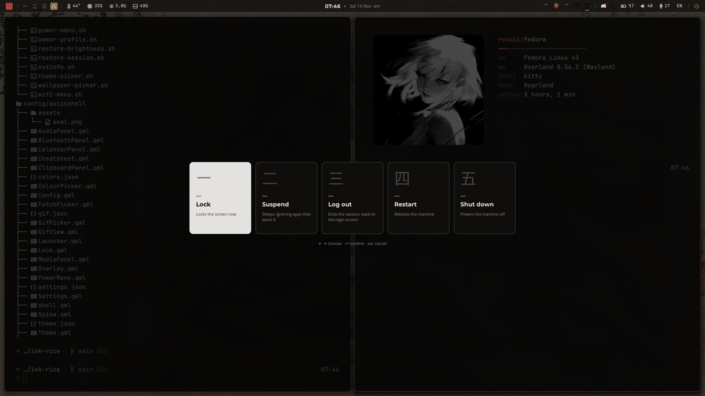

**Colours**: click the wheel and everything recolours: bar, borders, terminal, prompt, lock screen.

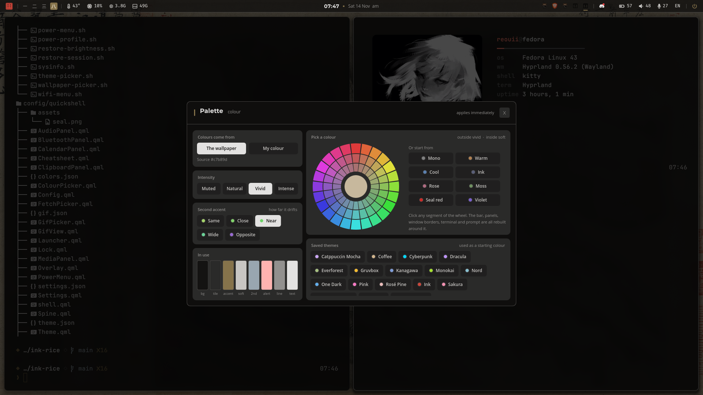

**Wallpaper**

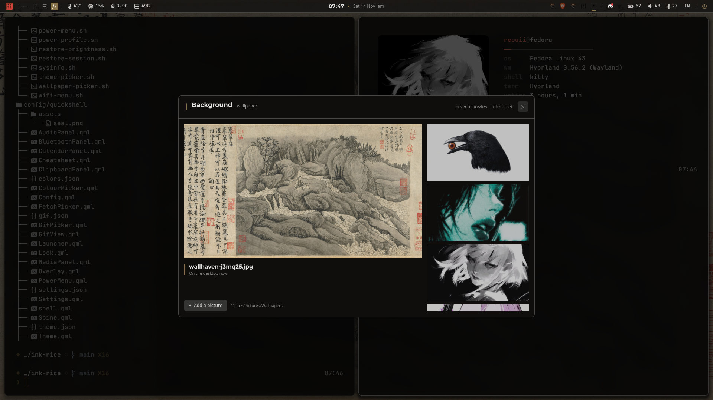

**GIF**: the picture on the Control Center and music panel.

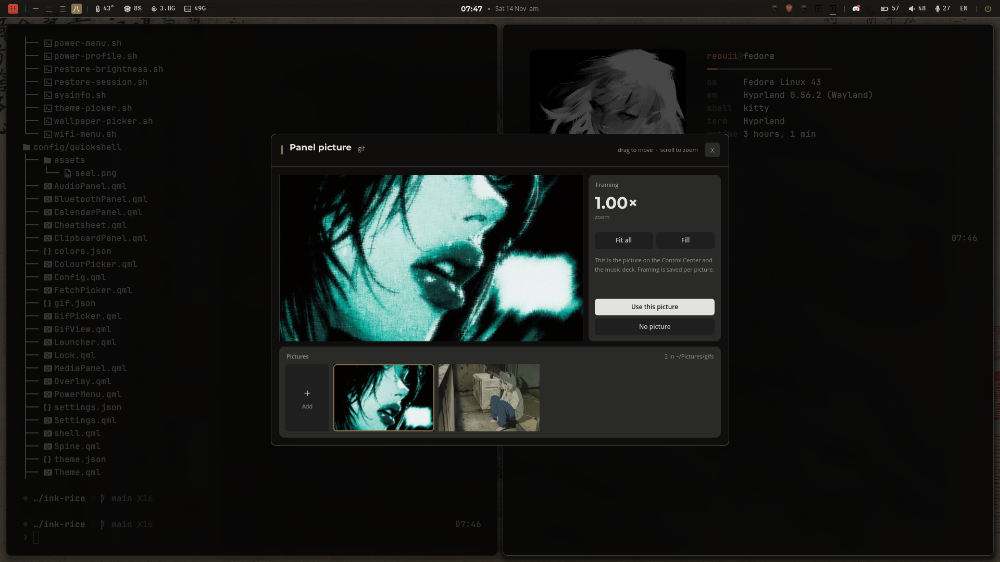

**Fastfetch picture**: pick any image or GIF for fastfetch. Also works from the terminal with `fetchpic`.

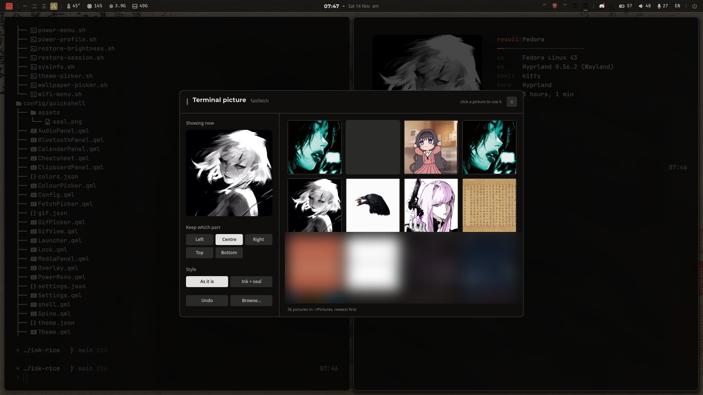

**Settings**

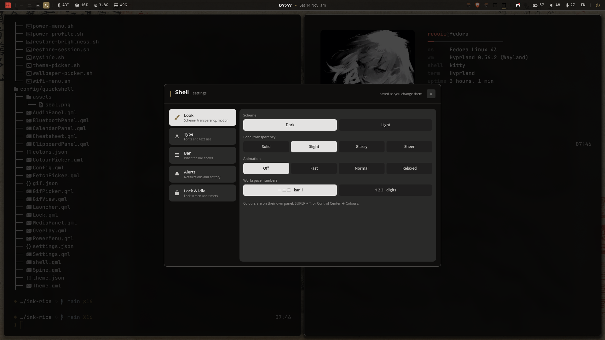

**Shortcuts**: read straight from `hyprland.conf`.

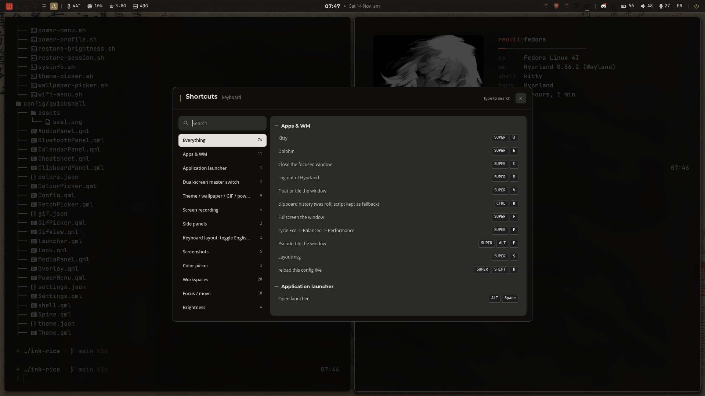

**Calendar**

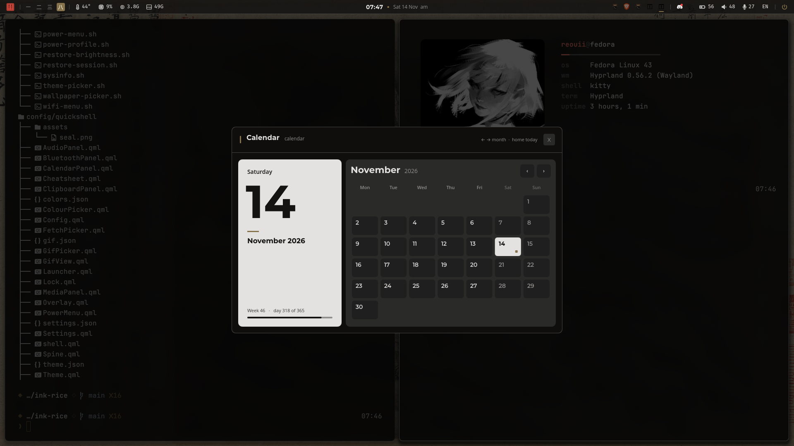

**Mixer**

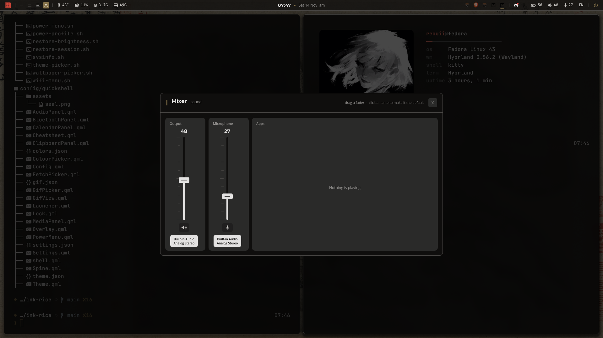

**Notification**

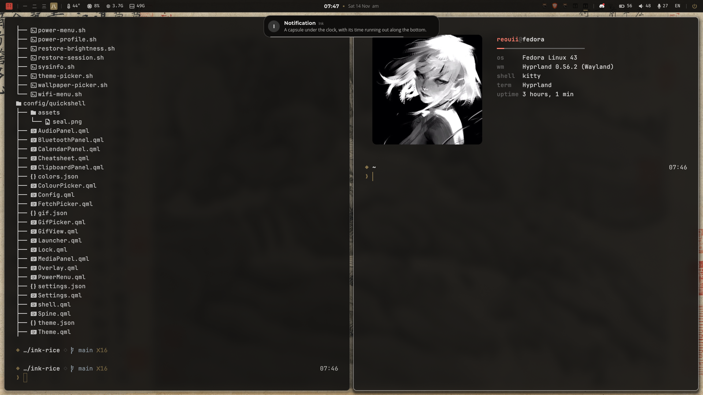

**Lock screen**: switches the keyboard to English before locking, so the password is never typed in the wrong layout.

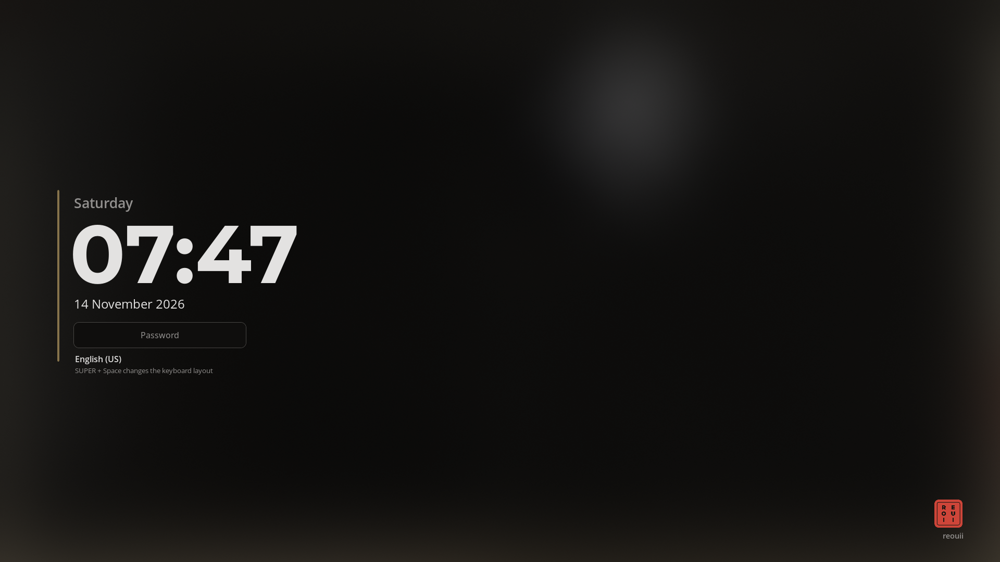

## Notes

- Workspace numbers are kanji. For normal digits: Settings → Look.
- Power profiles (Eco / Balanced / Turbo) need `tuned-ppd`.
- More detail on how things fit together is in [`config/hypr/RICE.md`](config/hypr/RICE.md).
